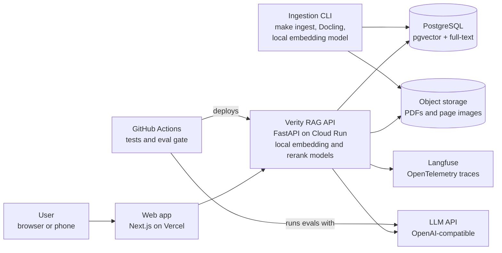
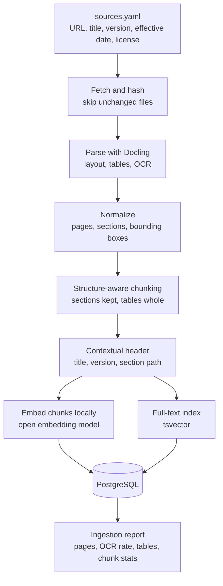
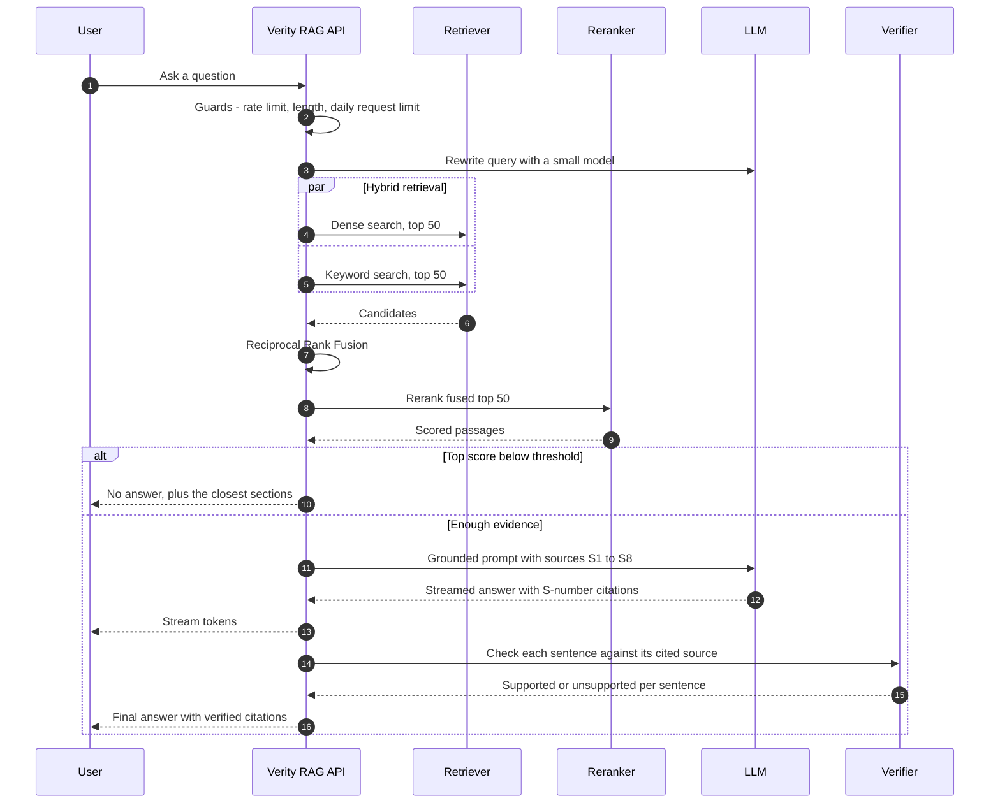
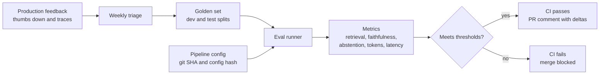
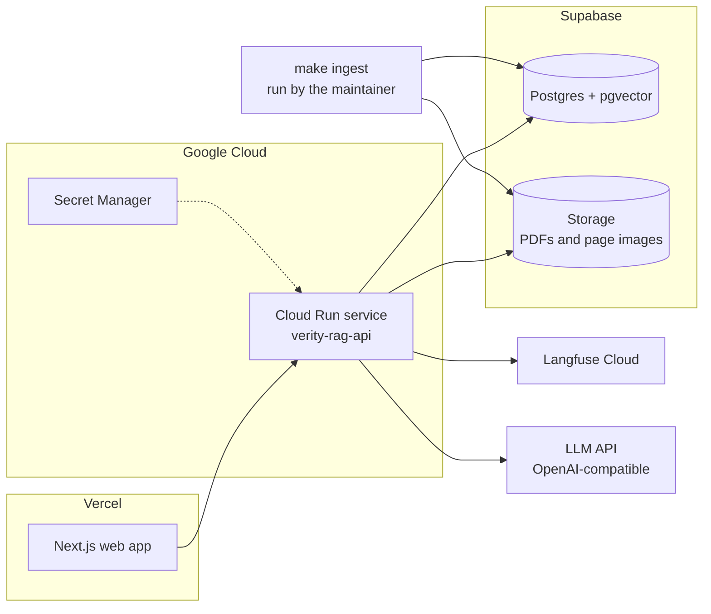

# Verity RAG design: Architecture

Part of the [Verity RAG design](../design.md). Section numbers (§) match the index and the GitHub issues.

---

## 6. Solution overview

Verity RAG has four parts.

1. **Ingestion pipeline (offline).** Fetches documents, parses them (including OCR and tables), splits them into chunks that follow the document's structure, and adds a short context header to each chunk ("Employment Act 2019 > Part III > Section 12: Overtime"). It then builds two indexes, vector and keyword.
2. **Query pipeline (online).** Rewrites the question for search, runs both searches, merges the results, reranks them, and builds a compact context. It asks the LLM to answer only from that context with citations, checks each sentence against its cited source, and then either answers or abstains.
3. **Evaluation loop.** A hand-written golden question set, automated metrics, an LLM judge validated against your own labels, and a CI gate that blocks regressions.
4. **Operations layer.** Tracing, metrics, token tracking, rate limiting, a daily request limit and dashboards.

The core idea: **you prove every design choice with a measurement.** Each technique (hybrid search, reranking, contextual headers) earns its place in an ablation table.

---

## 7. Architecture

### 7.1 System context

### 7.2 Ingestion pipeline

### 7.3 Query pipeline

### 7.4 Evaluation loop

### 7.5 Deployment

**LLM provider:** the diagrams show a generic OpenAI-compatible LLM API. The current provider and models are set in `configs/` and listed in [§17.1](06-operations-and-cost.md#171-models), so changing provider doesn't change the architecture.

**Why this deployment:** every service runs on its free plan ([§17](06-operations-and-cost.md#17-cost-model)), it scales to zero and it uses managed Postgres with pgvector. Ingestion is rare and offline, so it runs from the command line instead of as a cloud job; that keeps Docling and its OCR models out of the API image.
