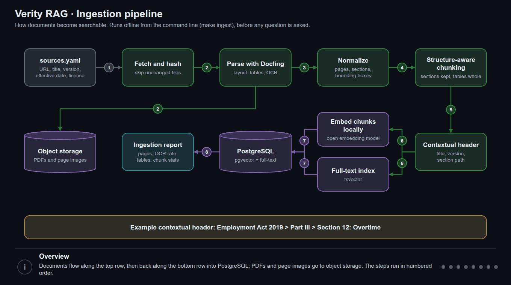

# Verity RAG design: Architecture

Part of the [Verity RAG design](../design.md). Section numbers (§) match the index and the GitHub issues.

---

## 6. Solution overview

Verity RAG has four parts.

1. **Ingestion pipeline (offline).** Fetches documents, parses them (including OCR and tables), splits them into chunks that follow the document's structure, and adds a short context header to each chunk ("Employment Act 2019 > Part III > Section 12: Overtime"). It then builds two indexes, vector and keyword.
2. **Query pipeline (online).** Rewrites the question for search, runs both searches, merges the results, reranks them, and builds a compact context. It asks the LLM to answer only from that context with citations, checks each sentence against its cited source, and then either answers or abstains.
3. **Evaluation loop.** A hand-written golden question set, automated metrics, an LLM judge validated against your own labels, and a CI gate that blocks regressions.
4. **Operations layer.** Tracing, metrics, token tracking, rate limiting, a daily request limit and dashboards.

The core idea: **you prove every design choice with a measurement.** Each technique (hybrid search, reranking, contextual headers) earns its place in an ablation table.

---

## 7. Architecture

Each diagram is an animated GIF that loops automatically, with a caption for each numbered step. Next to it is a static SVG with the same steps written out, for reading at your own pace, and the original Mermaid source. Numbered stages explain the design rather than exact execution timing; branches show alternative outcomes. These images illustrate the planned architecture, not implementation status or live activity.

[Watch the architecture walkthrough (MP4, 2 min 26 sec)](videos/architecture-walkthrough.mp4). This silent video follows the five animated diagrams in order, with chapter titles and on-screen step captions. Pause or seek to read at your own pace.

### 7.1 System context

[Static SVG with the steps written out](diagrams/system-context.svg) · [Mermaid source](diagrams/system-context.mmd)

### 7.2 Ingestion pipeline

[Static SVG with the steps written out](diagrams/ingestion.svg) · [Mermaid source](diagrams/ingestion.mmd)

### 7.3 Query pipeline

[Static SVG with the steps written out](diagrams/query.svg) · [Mermaid source](diagrams/query.mmd)

### 7.4 Evaluation loop

[Static SVG with the steps written out](diagrams/evaluation.svg) · [Mermaid source](diagrams/evaluation.mmd)

### 7.5 Deployment

[Static SVG with the steps written out](diagrams/deployment.svg) · [Mermaid source](diagrams/deployment.mmd)

**LLM provider:** the diagrams show a generic OpenAI-compatible LLM API. The current provider and models are set in `configs/` and listed in [§17.1](06-operations-and-cost.md#171-models), so changing provider doesn't change the architecture.

**Why this deployment:** every service runs on its free plan ([§17](06-operations-and-cost.md#17-cost-model)), it scales to zero and it uses managed Postgres with pgvector. Ingestion is rare and offline, so it runs from the command line instead of as a cloud job; that keeps Docling and its OCR models out of the API image.
