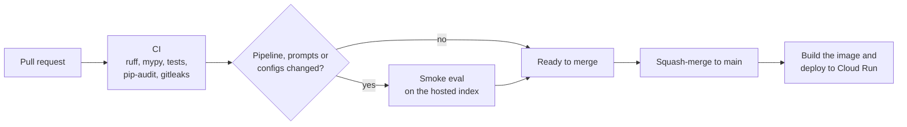

# Verity design: Testing, repository and CI/CD

Part of the [Verity design](../design.md). Section numbers (§) match the index and the GitHub issues.

---

## 19. Testing strategy

| Level | What | Tools |
| --- | --- | --- |
| Unit | Chunker, RRF, citation parser, threshold logic, redaction, cost calculator | `pytest` (no network) |
| Property-based | Chunker invariants: no text lost, page ranges valid, tables never split mid-row | `hypothesis` |
| Integration | Ingest a 3-PDF fixture corpus into Postgres, then query end-to-end | `docker compose` or a CI service container; recorded LLM responses (`pytest-recording`) so tests are free and deterministic |
| End-to-end | Ask → open a citation → give feedback | Playwright (one test) |
| Evals | Quality metrics (separate, cost-incurring) | `make eval` |
| Security | Injection set; dependency scans | Eval suite; `pip-audit` |

Coverage target: at least 80% on `src/verity/{retrieval,generation,verification,ingest}`.

---

## 20. Repository structure

```text
verity/
├── README.md                     # see §26 blueprint
├── AGENTS.md  CLAUDE.md          # agent instructions (§27)
├── CONTRIBUTING.md  SECURITY.md  CHANGELOG.md  VERSIONING.md  LICENSE  …
├── Makefile                      # setup, up, lint, test, ingest, ask, eval, report, run
├── pyproject.toml / uv.lock
├── docker-compose.yml            # postgres + pgvector for local development
├── .env.example
├── .pre-commit-config.yaml       # ruff, mypy, gitleaks, markdownlint
├── .markdownlint.jsonc
├── .github/
│   ├── workflows/ci.yml          # lint, types, unit and integration tests, pip-audit
│   ├── workflows/evals.yml       # PR smoke eval + sticky comment
│   ├── workflows/deploy.yml      # build and deploy the API (OIDC)
│   ├── dependabot.yml
│   ├── ISSUE_TEMPLATE/
│   └── PULL_REQUEST_TEMPLATE.md
├── configs/
│   ├── default.yaml              # provider URL, models, reasoning effort, k values, thresholds, daily limits
│   └── experiments/E0.yaml … E9.yaml
├── corpus/sources.yaml
├── src/verity/
│   ├── config.py
│   ├── llm/        (client.py, cache.py, usage.py)
│   ├── ingest/     (fetch.py, parse.py, chunk.py, enrich.py, embed.py, index.py, pipeline.py, report.py)
│   ├── retrieval/  (dense.py, keyword.py, fusion.py, rerank.py, assemble.py, retriever.py)
│   ├── generation/ (prompts/, generator.py, citations.py)
│   ├── verification/ (support.py, abstain.py)
│   ├── api/        (main.py, routes/, sse.py, ratelimit.py, limits.py)
│   ├── observability/ (tracing.py, redaction.py)
│   └── db/         (models.py, session.py, migrations/)
├── evals/
│   ├── datasets/   (golden_v0.jsonl, injection_v1.jsonl, README.md)
│   ├── judges/     (judge_prompt.md, calibration/)
│   ├── run.py  metrics.py  gate.py  report.py
│   ├── thresholds.yaml  baseline.json
│   └── reports/    (2026-11-28-a1b2c3d.md, charts/)
├── web/                          # Next.js app
├── infra/                        # Cloud Run service YAML (min 0, max 1 instance), budget alert, setup scripts
├── tests/ (unit/, integration/, e2e/)
└── docs/
    ├── design.md                 # design index; sections in design/
    ├── engineering-standards.md  labeling-guide.md  error-analysis.md
    ├── security.md  privacy.md  runbook.md
    ├── build-log.md              # notable coding-agent sessions (§27)
    └── adr/                      # MADR template + new or changed decisions
```

**Makefile targets (the README quickstart):** `make setup` · `make up` (compose) · `make ingest` · `make ask Q="…"` · `make eval SPLIT=dev` · `make report` · `make test` · `make lint` · `make run`.

---

## 21. CI/CD



- **Eval index:** the smoke eval reads the hosted index with a read-only role, so there is no index snapshot to build or restore ([§12.5](05-evaluation.md#125-ci-gating)).
- **Branch protection on `main`:** CI must pass. There are no required reviews for a solo maintainer; review your own PRs honestly and use draft PRs.
- **One environment:** merging to `main` deploys the API; roll back with Cloud Run revisions. The web app gets a Vercel preview deployment on every PR.
- **Releases:** tag `v0.1.0` (baseline), `v0.5.0` (quality targets), `v1.0.0` (deployed). Each tag carries a release note with eval numbers ([VERSIONING.md](../../VERSIONING.md)).
